# Atmosphere

PySME needs a model atmosphere to perform the radiative-transfer calculation.
Atmospheres are not included in each distribution; PySME uses the LFS (see [lfs](lfs.md)) to fetch the required model when it is first used.

If you want to provide your own model atmosphere file, it should be present in `~/.sme/atmospheres/`.

Each atmosphere model file describes a grid on which PySME interpolates to the requested stellar parameters.
PySME can extrapolate beyond the grid where the interpolation permits it and issues a warning when it does so.

The atmosphere also contains its own set of stellar parameters, which usually matches the SME structure.
The values can differ when, for example, the atmosphere is embedded and fixed or has not yet been calculated.

The atmopshere object has the following fields:

|Field name|Description|Allowed values or [Unit]|
|:---:|:---:|:---:|
|`teff`|Effective Temperature|[K]|
|`logg`|Surface Gravity|[log(cgs)]|
|`monh`|Metallicity||
|`abund`|The individual abundances (see [abund](#abund))||
|`vsini`|Projected Rotational velocity|[km/s]|
|`vmic`|Microturbulence velocity|[km/s]|
|`vmac`|Macroturbulence velocity|[km/s]|
|`source`|Filename of the atmosphere grid|see [lfs](lfs.md)|
|`depth`|The depth scale to use for calculations.|`RHOX` or `TAU`|
|`interp`|The depth scale to use for interpolation.|`RHOX` or `TAU`|
|`geom`|The geometry of the atmosphere.|Plane Parallel `'PP'`, Spherical `'SPH'`, or automatic `None` / `''`|
|`method`|The method to use for interpolation|`'grid'` for a model grid or `'embedded'` if only a single atmosphere is given|
|`rhox`|Mass column at each tabulated depth in the atmosphere|[$\mathrm{g~cm^{-2}}$]|
|`tau`|Continuum optical depth at each tabulated depth in the atmosphere||
|`temp`|Temperature at each tabulated depth in the atmosphere|[K]|
|`xna`|Atomic number density (including atomic components of molecules) at each tabulated depth in the atmosphere.|[$\mathrm{cm^{-3}}$]|
|`xne`|Electron number density at each tabulated depth in the atmosphere|[$\mathrm{cm^{-3}}$]|
|`rho`|Mass density at each tabulated depth in the atmosphere.|[$\mathrm{g~cm^{-3}}$]|
|`height`|Height above or below `radius` at each tabulated depth in a spherical atmosphere.|[cm]|
|`radius`|Stellar radius corresponding to `height` of zero in a spherical atmosphere|[cm]|
|`vturb`|Turbulent velocity used to generate the atmosphere|[km/s]|
|`lonh`|Ratio of mixing length to pressure scale height (`/H) used to generate the atmosphere.||
|`wlstd`|Wavelength for continuum optical depth scale.|Å, Default value: 5000Å|
|`opflag`|Flags that indicate whether to enable various opacity packages during the radiative transfer calculation||

## Automatic transfer geometry

Set `sme.atmo.geom = None` (or `''`) to allow a grid synthesis or fit to
cross between spherical and plane-parallel radiative transfer:

```python
sme.atmo.source = "marcs2014.sav"
sme.atmo.geom = None
sme.atmo.depth = "RHOX"
```

Automatic mode interpolates the atmospheric structure using the complete
grid, including mixed PP/SPH corners. It uses PP transfer at `logg >= 3.5`.
Below 3.5, it uses SPH transfer when all interpolation corners supply spherical
geometry (radius and height); otherwise it uses PP. Grids without spherical
geometry therefore continue to use PP at low gravity.

After interpolation, `sme.atmo.geom` reports the resolved transfer geometry.
The read-only `sme.atmo.geom_request` retains the request (`None`, `'PP'`, or
`'SPH'`), so repeated synthesis, copying, and saving/loading a new `.sme` file
preserve automatic mode. Assign `sme.atmo.geom` again to change the request.
Old saved files without request metadata retain their stored geometry as an
explicit request.

Explicit `'PP'` and `'SPH'` requests continue to select only matching grid
models and do not use the automatic gravity threshold. Embedded atmospheres
retain their supplied geometry and are not switched automatically.

The automatic threshold is a hard change in the radiative-transfer geometry,
so spectra and fit objectives need not be continuous across `logg = 3.5`,
even if the interpolated atmospheric structure is continuous. This option
raises `AtmosphereError` if it selects SPH transfer with a TAU depth scale;
use RHOX for spherical transfer.

See the [boundary testing guide](../dev/auto_geometry_testing.md) for a
reproducible synthesis and fitting diagnostic and its current limitations.

## Atmosphere grids:

- recommended:
  - marcs2012.sav [(Gustafsson et al. 2008)](https://ui.adsabs.harvard.edu/abs/2008A%26A...486..951G)
  - marcs2012p_t0.0.sav
  - marcs2012p_t1.0.sav
  - marcs2012p_t2.0.sav
  - marcs2012s_t1.0.sav
  - marcs2012s_t2.0.sav
  - marcs2012s_t5.0.sav
  - marcs2012t00cooldwarfs.sav
  - marcs2012t01cooldwarfs.sav
  - marcs2012t02cooldwarfs.sav

- deprecated:
  - atlas12.sav
  - atlas9_vmic0.0.sav
  - atlas9_vmic2.0.sav
  - ll_vmic2.0.sav

### Grid plots

`marcs2012.sav`
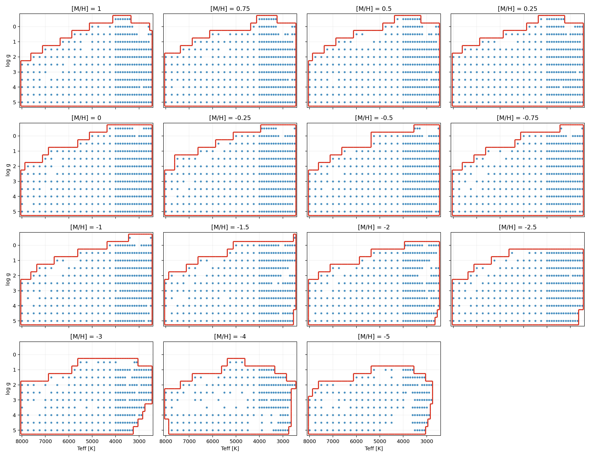

`marcs2012p_t0.0.sav`
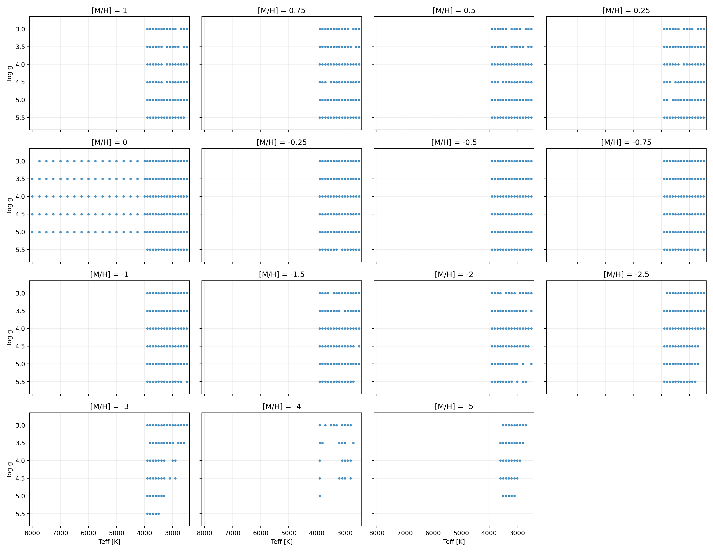

`marcs2012p_t1.0.sav`
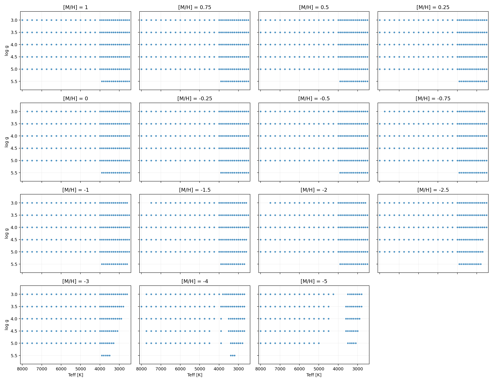

`marcs2012p_t2.0.sav`
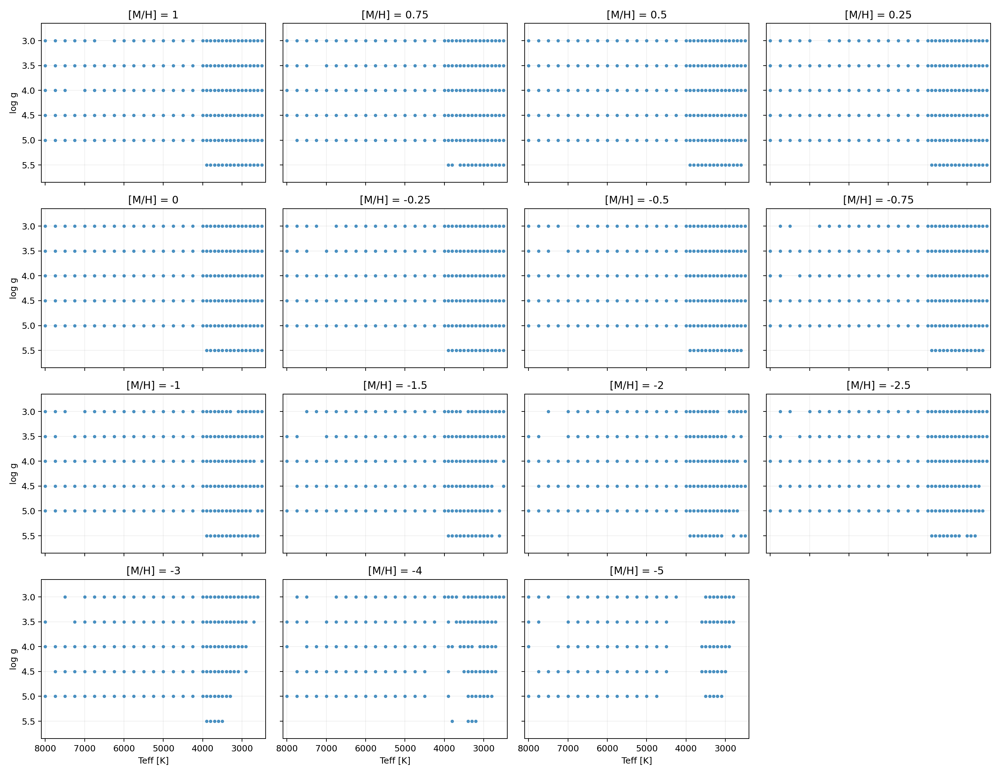

`marcs2012s_t1.0.sav`
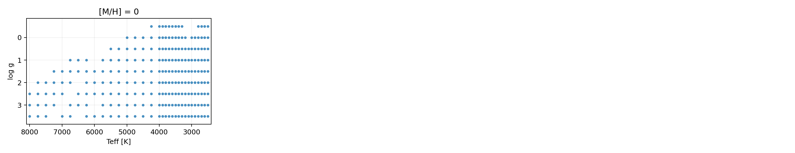

`marcs2012s_t2.0.sav`
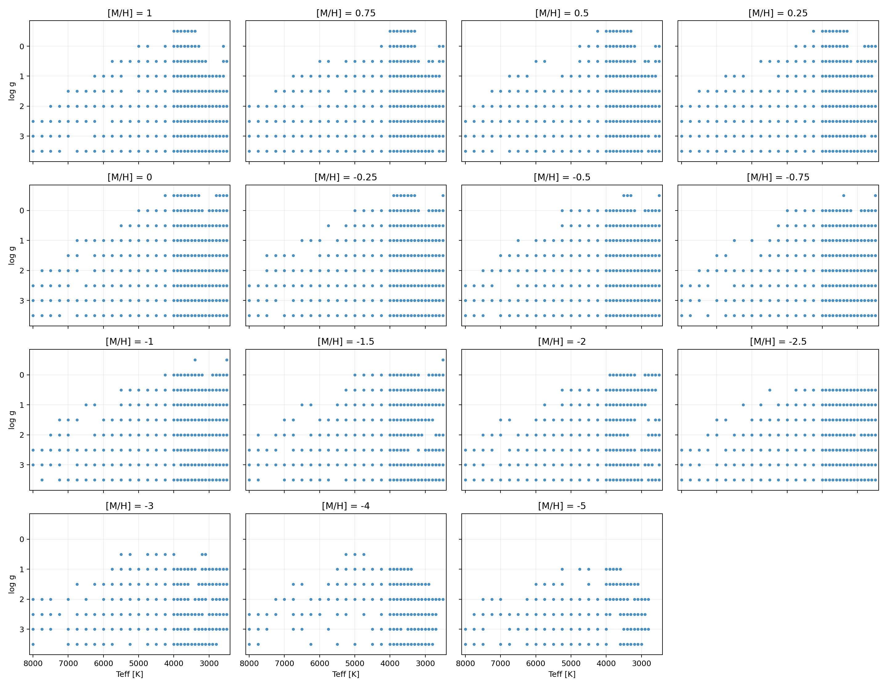

`marcs2012s_t5.0.sav`
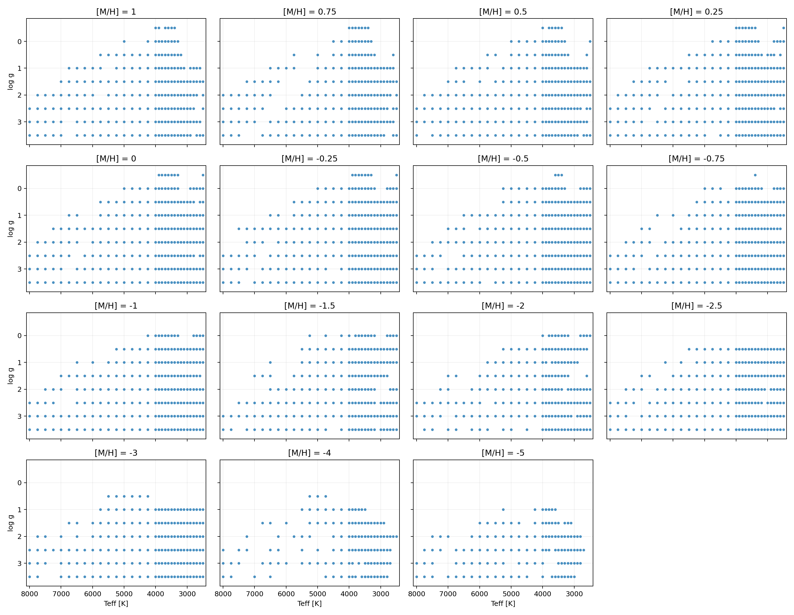

`marcs2012t00cooldwarfs.sav`
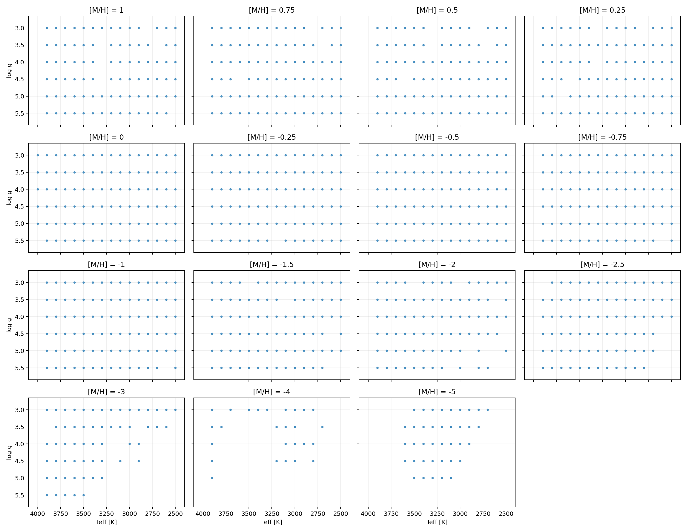

`marcs2012t01cooldwarfs.sav`
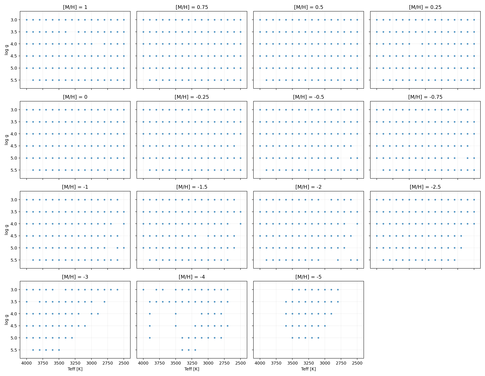

`marcs2012t02cooldwarfs.sav`
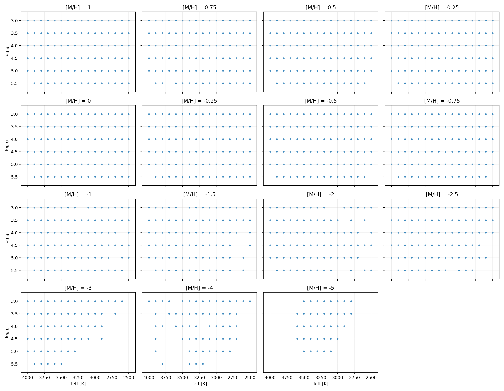

`atlas12.sav`
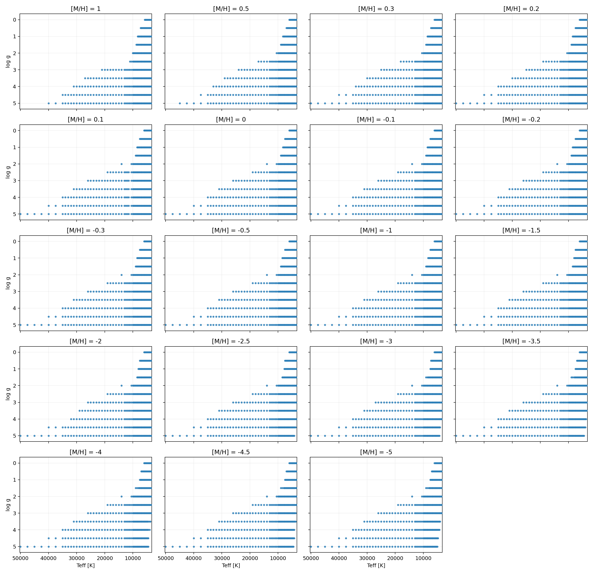

`atlas9_vmic0.0.sav`
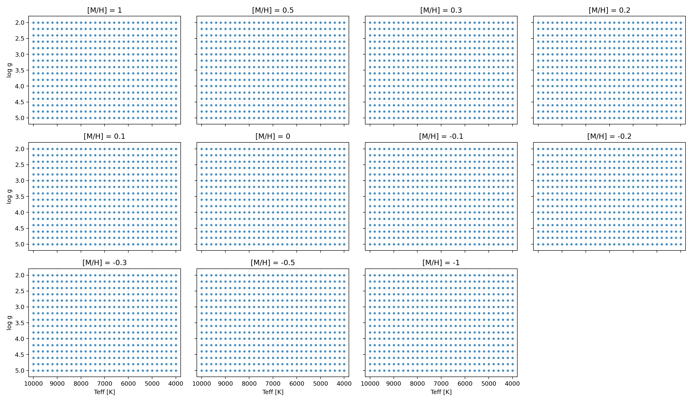

`atlas9_vmic2.0.sav`
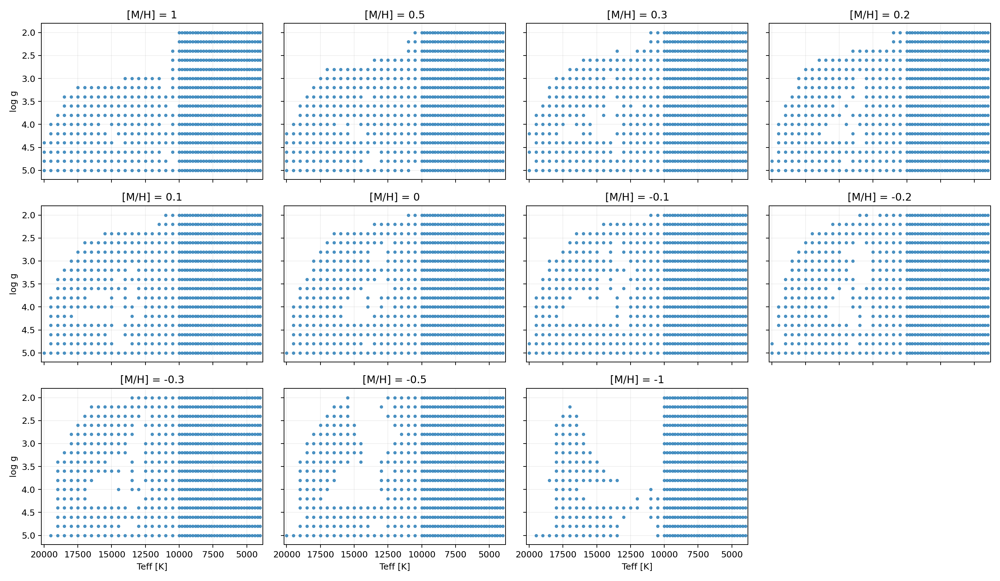

`ll_vmic2.0.sav`
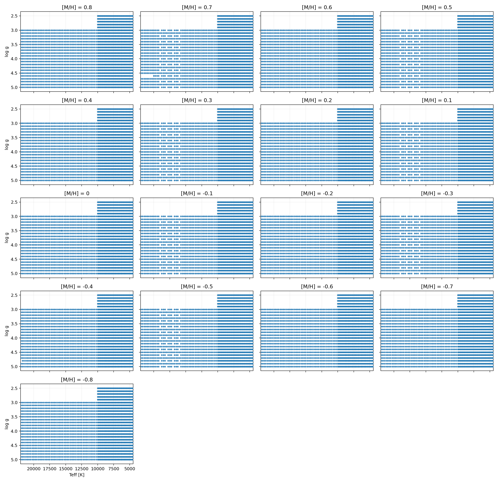
